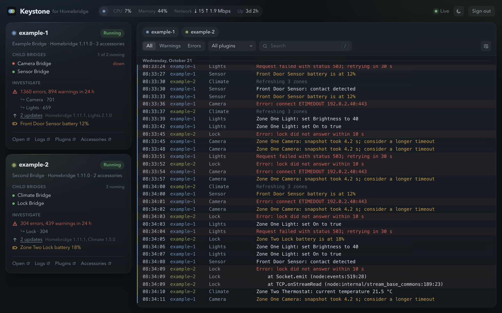

# Keystone for Homebridge

[](https://github.com/tbaur/keystone/actions/workflows/ci.yml?query=branch%3Amain)
[](https://github.com/tbaur/keystone/actions/workflows/codeql.yml?query=branch%3Amain)
[](https://github.com/tbaur/keystone/releases/latest)
[](LICENSE)
[](https://nodejs.org/)
[](https://www.typescriptlang.org/)

Keystone is one page for several Homebridge instances. Many setups run more than one instance, for example to keep untrusted plugins apart from trusted ones, or to try changes on a development instance. Keystone merges their logs into one live stream and shows each instance's status, child bridges, updates and low batteries. Links go straight to the right page in each Homebridge UI.



Keystone reads from each Homebridge UI's API with a non-admin account. It never changes anything in Homebridge. The server collects the logs all the time, whether or not a browser is open, and keeps them in SQLite for `retentionDays`. Older lines are removed every hour, so the history is a rolling window. The log survives restarts, and you can scroll back past what the Homebridge UI keeps.

## What you get

- **One live log for every instance.** Each instance gets its own colour. The log follows new lines while you are at the bottom. If you scroll up, it stops following and counts what arrives below. Scrolling to the top loads older lines from the stored history.
- **Filters that stay in the URL.** You can filter by instance, level (warnings, errors), plugin and text, and a filtered view can be bookmarked. Clicking an instance or plugin name in a line filters to it.
- **No gaps.** When the browser reconnects, the server sends the lines it missed. When Keystone reconnects to Homebridge, it drops the lines that the Homebridge UI replays and it has already stored. The log marks the time it lost the stream and the time it came back. While Keystone itself is stopped, nothing is collected. When it starts again, it can recover only the lines that the Homebridge UI replays.
- **Status at a glance.** Each instance shows whether it is running, its child bridges, the installed version of Homebridge and of each plugin, errors and warnings per plugin over 24 hours, and low batteries. When a newer version is available, the card shows it next to the installed one. A plugin that runs in a child bridge shows its version on that bridge's row, and plugins that run in the main bridge are listed under their own heading. When an instance stops answering, its card keeps the last known data and says how old it is. The top bar shows CPU, memory, network throughput in Mbps and uptime for the machine that one instance runs on. The instance's colour dot opens a menu to pick another, and the browser remembers the choice.
- **Its own users.** Each person signs in with a user name and password. You add and remove users with `npm run secrets`, so there is no admin page. The Homebridge passwords stay on the server.

## Requirements

- Node.js 24 or newer
- Homebridge UI 5 (`homebridge-config-ui-x`)
- A non-admin user in each Homebridge UI. The steps are in [docs/operations.md](docs/operations.md#create-the-homebridge-users).
- For the accessory and battery panel, Homebridge must run in insecure mode (`-I`). Without it, everything else still works.

## Quick start

```bash
npm ci
npm run build
cp config.example.json config.json
$EDITOR config.json            # add each instance
npm run secrets                # asks for a first user and each Homebridge password
npm start
```

`config.json` holds only settings, so a deploy tool can write it. `npm run secrets` writes the passwords to `secrets.json` with mode 600, and the server refuses to start if the file has any group or other permission. Run `npm run secrets` again to change a Homebridge password. Enter keeps each current value. `npm run secrets -- --user <name>` adds a user or changes that user's password, and `npm run secrets -- --remove-user <name>` removes one. Restart Keystone after each change.

Open `http://localhost:8590`. The cookie is `Secure` by default. Most browsers keep a `Secure` cookie on `localhost` over plain HTTP, but not every browser does. If signing in brings you back to the login page, use HTTPS. For anything beyond trying it out, put Keystone behind a TLS proxy as described in [docs/operations.md](docs/operations.md).

## Configuration

The server reads `--config <path>`, then `KEYSTONE_CONFIG`, then `./config.json`. At start it checks the whole file, reports every problem at once, and exits with code 78 if there are any. That includes keys it does not know, so a misspelt key never falls back to a default without a word. The checks and their limits live in [`src/server/config.ts`](src/server/config.ts).

| Key | Default | Meaning |
|---|---|---|
| `listen.host` | `127.0.0.1` | Address to listen on. Keep loopback behind a proxy. |
| `listen.port` | `8590` | Port to listen on. |
| `dataDir` | `data` | Holds `dashboard.sqlite`. Relative to the config file. Keystone makes it private to its user. |
| `secretsFile` | `secrets.json` | Where `npm run secrets` writes the users and passwords. Relative to the config file. |
| `retentionDays` | `7` | Days of log history to keep, 1 to 90. Older lines are removed at start and every hour. |
| `cookieSecure` | `true` | Mark the session cookie `Secure` and send HSTS. Turn off only for plain HTTP on a trusted LAN. |
| `trustProxy` | `false` | Take the client address from `X-Real-IP` when the request comes from loopback. Turn on behind nginx on the same host, so login throttling and the logs see the real client. |
| `logLevel` | `info` | `debug`, `info`, `warn` or `error`. A non-empty `KEYSTONE_LOG_LEVEL` overrides it. |
| `instances[].name` | required | Short id such as `example-1`: lowercase letters, digits and dashes. |
| `instances[].apiUrl` | required | The Homebridge UI origin as the server reaches it, usually `http://127.0.0.1:<port>`, with no path. |
| `instances[].uiUrl` | required | The Homebridge UI as your browser reaches it, for links. It may have a path. |
| `instances[].username` | required | The non-admin Homebridge UI user. Its password goes in the secrets file. |

## Development

```bash
npm run check                  # typecheck, lint and tests
npm run build && npm run dev:fake
```

`dev:fake` runs Keystone against two fake Homebridge instances that write a steady log, so you can work on the UI without a real Homebridge. Open `http://localhost:8590` and sign in as `example` with `keystone-dev-password`. Its data goes to `data/dev`.

The tests run the TypeScript sources directly through Node's type stripping. The integration tests start a fake Homebridge UI (`test/helpers/fake-homebridge.ts`) that speaks the real login, REST and socket.io log protocol. CI runs `npm run check` and `npm run build` on the oldest supported Node and the current release.

## Documentation

- [docs/architecture.md](docs/architecture.md) explains how the parts fit together, how replayed lines are dropped and the security model.
- [docs/operations.md](docs/operations.md) covers running it as a service behind nginx, health checks, troubleshooting, backups and upgrades.
- [CHANGELOG.md](CHANGELOG.md) lists the changes in each version.

## Contributing

Bug reports, ideas and pull requests are welcome. [CONTRIBUTING.md](CONTRIBUTING.md) covers the setup, the checks and the commit style. Everyone taking part follows the [Code of Conduct](CODE_OF_CONDUCT.md).

## Security

Please report a vulnerability privately, as described in [SECURITY.md](SECURITY.md), and not in a public issue.

## License

Copyright 2026 tbaur

Licensed under the Apache License, Version 2.0. See [LICENSE](LICENSE) file for details.
