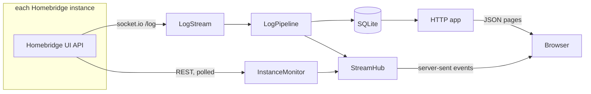

# Architecture

Keystone is one Node.js process with one runtime dependency, `socket.io-client`. It talks to each Homebridge UI the same way the UI's own browser page does, stores what it reads in SQLite, and serves a small page that gets updates over server-sent events.

This document explains the design and the reasons for it. Exact limits and timings are named constants at the top of the file that uses them, and the tests in `test/` pin the behaviour. When this document and the code disagree, the code and its tests are right.

## Source layout

| Path | Holds |
|---|---|
| `src/server/main.ts` | Command line, config loading, signals and exit codes |
| `src/server/dashboard-server.ts` | Wires the parts together, runs maintenance, and starts and stops the server |
| `src/server/dashboard.ts` | The overview and the health answer, built from the instance monitors |
| `src/server/config.ts`, `secrets.ts` | Reading and checking `config.json` and the secrets file |
| `src/server/logger.ts`, `json.ts` | Structured logging, and safe reading of untyped JSON |
| `src/server/homebridge/` | The Homebridge side: API client, log stream, pollers, backoff, and the mappers that pick fields out of API answers |
| `src/server/logs/` | Splitting lines, reading timestamps, dropping replayed lines, batching writes |
| `src/server/store/` | SQLite schema, migrations, queries and the search text |
| `src/server/auth/` | Password hashing, sessions and login throttling |
| `src/server/http/` | Routes, the event stream, static files and security headers |
| `src/server/cli/` | `npm run secrets` |
| `src/shared/types.ts` | The JSON shapes that server and browser share |
| `src/web/` | The page: plain TypeScript and CSS with no framework and no bundler |
| `test/` | Unit tests named after the module they cover, plus integration tests against the fake Homebridge UI in `test/helpers/` |
| `test/web/` | Tests of the log view against a small fake DOM, with their own tsconfig so that the DOM types stay out of the server checks |

## Reading from Homebridge

Each instance gets one `HomebridgeApi`, shared by its pollers and its log stream. It logs in with the non-admin user and reuses the token. Calls that start together share one login, and the token is renewed shortly before it expires. A 401 causes one fresh login and one retry. Every request has a timeout, and redirects are refused, because a redirect would carry the login body to wherever it points.

When Homebridge UI rejects the login, the client stops trying until `AUTH_RETRY_MS` has passed, for every caller at once. Homebridge UI locks a user after repeated failures within a few minutes, and this wait is long enough that a wrong password can never cause that lock.

`InstanceMonitor` runs three pollers per instance: status (with child bridges and host stats) often, accessories less often, and plugins and versions rarely. `DEFAULT_INTERVALS` in `instance-monitor.ts` has the numbers. Each poller waits its interval after a run finishes, so slow answers never pile up. After a failure the wait grows with jitter, up to a few intervals, and it returns to the interval after the next success. A rejected login waits `AUTH_RETRY_MS`.

A failed poll keeps the last good data. The card shows how old the status is while Homebridge UI is unreachable, and it shows plugin or accessory errors next to the data that they affect. If Homebridge is not in insecure mode, the accessories call answers 400. Keystone logs that once and leaves the panel empty, without showing an error.

`/api/accessories` lists services, several per accessory. The mappers count an accessory once per bridge and accessory id, so a sensor with a battery service counts as one accessory and appears once in the low battery list.

The mappers in `mappers.ts` copy fields one by one into Keystone's own types. Fields that are not copied never reach the browser. This matters because the same API answers include the HomeKit setup PIN and pairing IDs.

## The log stream

`LogStream` opens the UI's socket.io `/log` namespace and sends `tail-log`, as the UI's log page does. Homebridge UI then sends a short banner, replays the end of the log file, and streams new lines as they are written. If the socket connects but sends nothing at all, the stream gives up after its connect timeout and tries again.

Before each connection, `LogStream` asks Homebridge UI for the host's time zone. Homebridge stamps each line with the host's locale format and local time, so the time zone is needed to turn a stamp into an instant. `logs/timestamp.ts` reads the common locale formats. When the day and month could be either way round, it takes the reading closer to the arrival time. A stamp that is impossible for the arrival time is replaced by the arrival time.

`LineSplitter` turns the chunks into lines and cuts a runaway line at `MAX_LINE`. Blank lines are dropped. `parseLine` reads the timestamp, plugin and level of each line and keeps the ANSI colours for display. The level comes from the colour that Homebridge gives the message: red is an error, yellow is a warning, dim is debug. A line without a timestamp, such as a stack trace, takes the plugin, level and time of the line above it.

### Dropping the replay

Every connection starts with a replay, so a reconnect would store the same lines twice. `replayStart` in `logs/replay.ts` finds where the replay overlaps what is already stored:

1. It takes the last stored line for the instance and looks for it in the replay.
2. For each place where it appears, it counts how many lines before it also match the stored lines.
3. The place with the longest match wins. On a tie, a match that used every stored line it could compare beats one that stopped at a different line. Otherwise the later place wins, because repeated lines are common at the end of a log. A match needs a few lines, unless it reaches the start of the replay.
4. Lines after that place are new and get stored.

If nothing overlaps, for example because the log file was rotated or Keystone was away for a long time, the replay is stored from its first timestamped line, and the server logs that it found no overlap. The lines before that are the tail of a cut-off line or stack trace. The comparison uses the text without colours, so a change in colour output does not break it. `test/replay.test.ts` holds the cases.

The replay ends once the stream has been quiet for a moment, or after a time limit, whichever comes first. Both are counted from the data itself, not from the connection, so a slow host does not end the replay before it has started.

The stream only counts as connected when the first data arrives, so a rejected token never shows as connected. When it drops, a system line "Log stream lost" goes into the log at warn level. After the replay, "Log stream reconnected" is written at info level. You can see the gap in the same place where you read the log.

## Storage

SQLite runs in WAL mode through Node's built-in `node:sqlite`. There are two tables:

- `logs` holds the raw text of each line with its colours, and a `search` column: the plugin name and the message without colours, in lower case. A trigram full-text index on `search` answers text searches. It stores no positions, which keeps it close to the size of the text. Other indexes match the filters, each in page order.
- `sessions` holds the SHA-256 of each session token, never the token, with its user and a fingerprint of that user's password hash.

`LogPipeline` collects lines for a short time and writes them in one transaction, so a replay becomes a few writes. A burst larger than it holds in that time is dropped and counted. When writes fail, it logs the error at most once a minute with the number of lines lost, and `/healthz` reports the store as failing until a write succeeds. A failure while sending those stored lines to open browsers is logged on its own. The lines are already stored, so the store stays ok.

The log streams run in the server from start to stop, so collection does not depend on an open browser. At start and then every hour, maintenance removes lines that arrived more than `retentionDays` ago. Then, whatever the retention, it removes the oldest lines past the `MAX_STORED_LINES` ceiling in `dashboard-server.ts`, so a runaway plugin cannot fill the disk. It deletes in small batches and lets other work run between them, so a large prune never stalls the server. Then it deletes expired sessions and lets SQLite refresh its query statistics. Retention counts from arrival, so a replay of old lines is kept for the full period. The 24-hour error counts use the log time.

Migrations are numbered by SQLite's `user_version`. A new version adds a step to the list in `database.ts`. Old steps never change. A database from a newer Keystone is refused at start. `test/database.test.ts` migrates an old database and checks that the indexes are used.

## Serving the browser

The page loads one page of lines from `GET /api/logs` with the current filters, then opens `GET /api/stream` with the id of the newest line it has. The stream is plain server-sent events:

| Event | Data |
|---|---|
| `overview` | Status and host stats for every instance, and the 24-hour error and warning counts. Bursts of changes are sent once. |
| `logs` | New lines. The event id is the id of the last line. |
| `reset` | The browser fell too far behind and should reload the page. |

EventSource reconnects by itself and sends `Last-Event-ID`, so the server sends exactly the lines that the browser missed. A comment goes out regularly to keep proxies from closing the connection. A browser that stops reading is dropped once too much data waits for it. Each stream checks its session again with every keep-alive, and a sign-out ends that session's streams at once.

In the browser, `LogView` keeps lines in log order, by time and then id. Live lines usually go at the end. A line that arrives late, for example from an instance whose replay came later, goes into its place. While the reader follows the log, the view keeps a bounded number of rows. While the reader is scrolled up, new lines are held and counted instead of drawn. Any scroll up stops following at once, so a slow scroll is not pulled back down by the next batch of lines. Jumping to the latest reloads the page of lines when too many arrived in the meantime. Older rows load again by scrolling up. `test/web/log-view.test.ts` holds the cases.

The server filters pages and history. The browser filters live lines with `matches()` in `filters.ts`, so live lines need no extra request. Both search the plugin name and the message without colours, ignoring case and spaces at either end. A test in `test/web.test.ts` checks that the two agree.

## Security model

Keystone is a read-only window on Homebridge for a few trusted people. The design assumes that the network can see the traffic, and that the browser holds no Homebridge credentials.

- **Homebridge credentials stay on the server.** They live in the secrets file, apart from `config.json`, so a deploy tool can manage the settings without ever handling a password. The secrets file must have no group or other permissions, and the server refuses to start otherwise. It also refuses a `config.json` that holds a password, and an `apiUrl` with credentials in it. The Homebridge user is not an admin, so it cannot restart Homebridge, change the config or read pairings. Keystone warns at start when an `apiUrl` uses plain HTTP to another host, because the password would cross the network unencrypted.
- **A non-admin Homebridge user can still read the setup PIN and change accessories.** Keystone never forwards a write. Each answer is copied into Keystone's own types by hand, so the PIN and setup code are left out. A test checks that neither reaches the overview that the browser gets.
- **A password per user, hashed with scrypt** and compared in constant time. An unknown user name is checked against a dummy hash, so it takes as long as a wrong password and gets the same answer.
- **Login throttling** counts failures per client address, with IPv6 counted per /64, and per known user name from any address. Past a few free failures, a lock starts at a minute and doubles with each further failure, up to a ceiling. A try is reserved before the password is checked, so parallel tries cannot slip past the limit, and only a couple of checks run at once. A cap on failures per minute from everywhere together slows a distributed attack. `test/auth.test.ts` has the exact rules.
- **Sessions** are 32 random bytes in an `HttpOnly`, `SameSite=Strict` cookie, which is also `Secure` when `cookieSecure` is on. A session renews while it is used, but ends a fixed time after sign-in however often it is used. It stops working once its user is no longer in the secrets file or that user's password changes. Signing out deletes the session on the server and ends its streams.
- **Requests that change state** (`POST /api/login`, `POST /api/logout`) must be same-origin according to `Sec-Fetch-Site`. Bodies are JSON only and small.
- **The client address** is the socket address. With `trustProxy` on, a request from loopback may name the real client in `X-Real-IP`, and only a valid IP address is accepted there.
- **The page** is served with a strict Content Security Policy that allows only same-origin scripts and styles and no framing. `X-Content-Type-Options`, `Referrer-Policy: no-referrer` and HSTS (when `cookieSecure` is on) are also set. Log text is only ever added to the page as text nodes, never as HTML.
- **Health** is public, but only a signed-in user sees the instance names and states. Anyone else gets the overall status.
- **Errors** go to the server log with a request id. The browser only sees a generic message and that id.

## What it does not do

These are left out on purpose, to keep Keystone small:

- No control of Homebridge: no restarts, no config edits, no accessory changes. Use the Homebridge UI for those, which Keystone links to.
- No roles and no user admin page. Every user sees everything, and users are managed with `npm run secrets`.
- No alerting. `/healthz` is there for an uptime monitor to watch.
- No metrics history or charts. The host numbers are the current values only.
